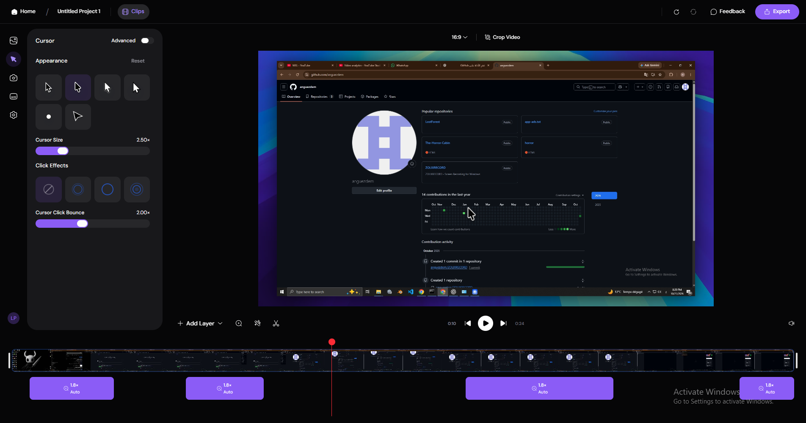
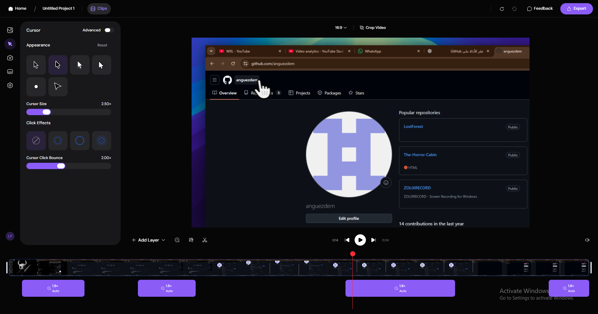
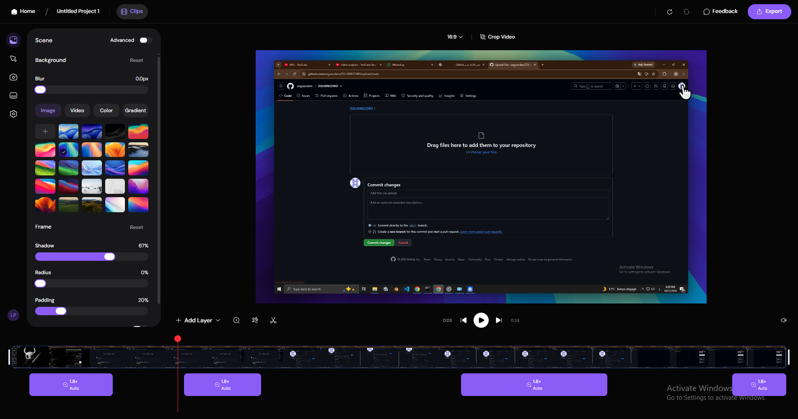
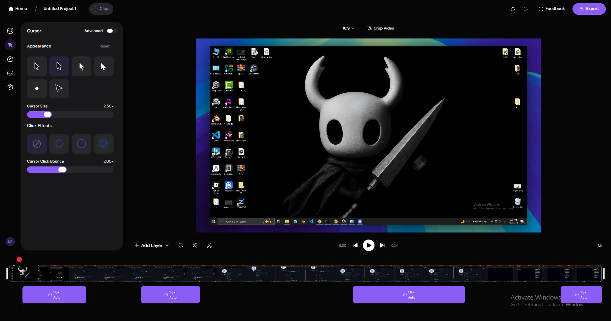

<div align="center">

# 🔴 ZOLIXRECORD

### A Modern Screen Recording Tool for Windows

**Capture your screen. Keep it simple.**

A Windows screen recording application developed by ZOLIX STUDIOS.

<br>

[](https://github.com/anguezdem/ZOLIXRECORD)
[](https://github.com/anguezdem/ZOLIXRECORD/releases/latest)
[](https://github.com/anguezdem/ZOLIXRECORD)

<br>

<a href="https://github.com/anguezdem/ZOLIXRECORD/releases/latest">
  
</a>

</div>

---

## 📸 Screenshots

Explore the ZOLIXRECORD interface.

<div align="center">




<br><br>




</div>

---

## ✨ About ZOLIXRECORD

**ZOLIXRECORD** is a Windows screen recording application developed under the ZOLIX STUDIOS identity.

This repository provides information about the application, screenshots, release downloads, and installation instructions.

## 🚀 Features

- 🖥️ Windows desktop application
- 🎬 Screen recording application
- 📥 Downloadable executable release
- ⚡ Convenient access through GitHub Releases

*Features listed here should be updated to match the capabilities of your current build.*

---

## 📥 Download & Installation

### Option 1 — Download from GitHub

1. Open the [latest release](https://github.com/anguezdem/ZOLIXRECORD/releases/latest).
2. Find the **Assets** section.
3. Download the ZOLIXRECORD `.exe` file.
4. Open the downloaded file and follow any instructions displayed.

### Option 2 — Download using Windows CMD

You can download ZOLIXRECORD directly from the Windows Command Prompt without installing Git.

**Step 1. Open CMD**

Press `Win + R`, type `cmd`, and press Enter.

**Step 2. Download ZOLIXRECORD**

Copy and run the following command:

```cmd
curl -fL -o ZOLIXRECORD.exe "https://github.com/anguezdem/ZOLIXRECORD/releases/latest/download/ZOLIXRECORD.exe"
```

**Step 3. Run the application**

```cmd
ZOLIXRECORD.exe
```

Run the command from the directory where the executable was downloaded. If necessary, navigate to that directory first using `cd`.

**Important:** The download command requires the uploaded release asset to be named exactly `ZOLIXRECORD.exe`. If your file has a different name, update the command to match it.

Only run executable files from sources you trust.

---

## 💻 System Requirements

- **Operating System:** Windows
- **Application format:** `.exe`
- **Additional requirements:** To be confirmed.

---

## 📦 Releases

Get the latest version or explore previous releases.

<div align="center">

[](https://github.com/anguezdem/ZOLIXRECORD/releases/latest)

[View All Releases](https://github.com/anguezdem/ZOLIXRECORD/releases)

</div>

---

## 🐛 Issues & Feedback

Found a bug or have a suggestion?

[**Open an Issue on GitHub →**](https://github.com/anguezdem/ZOLIXRECORD/issues)

---

## 👨‍💻 Developer

<div align="center">

### ZOLIX STUDIOS

Independent software development.

**ZOLIXRECORD — CAPTURE WHAT MATTERS.**

[GitHub Repository](https://github.com/anguezdem/ZOLIXRECORD)

</div>

---

<div align="center">

Made with dedication by **ZOLIX STUDIOS**

</div>
